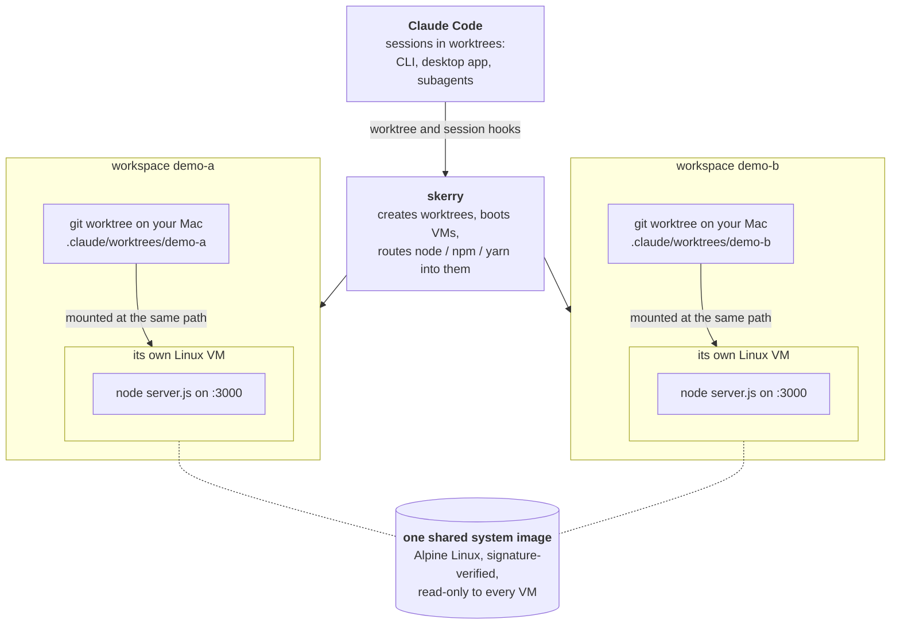
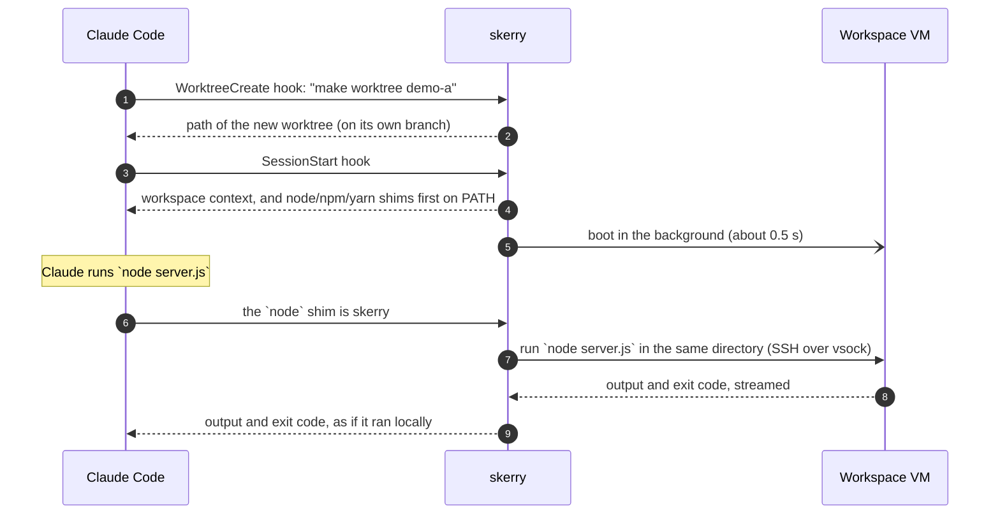

# skerry

**Every checkout gets its own lightweight Linux VM, so parallel work never
collides.**

skerry is for developers who work on several branches at once, and for coding
agents like Claude Code that run many sessions side by side. Each checkout
(a git worktree) gets a small, fast VM with its own processes, ports and
filesystem, and soon its own databases and services. Two branches can run the
same app on the same port at the same time, and neither notices the other.

> **Status: early development, macOS on Apple Silicon.** Workspaces, Claude
> Code integration and per-workspace VMs work today. Networking, services
> (Postgres, Redis, Temporal), database seeding and automatic detection are
> next. See [What works today](#what-works-today).

---

## The problem

Git worktrees give each branch its own files, but everything else is shared:

```console
$ node server.js          # worktree A
listening on :3000
$ node server.js          # worktree B, at the same time
Error: listen EADDRINUSE: address already in use :::3000
```

The same goes for the database (one branch's migration breaks another's), for
Redis keys, background workers and `/tmp`. With five Claude sessions in five
worktrees, they all fight over `localhost`.

## What skerry does

The same two servers, each in its own skerry workspace:

```console
$ node server.js          # workspace demo-a
listening on :3000 in demo-a
response: served by demo-a

$ node server.js          # workspace demo-b, at the same time
listening on :3000 in demo-b
response: served by demo-b
```

That output is from two real Claude Code sessions running in parallel.
Neither session had to know about skerry: it typed `node`, as usual.

- **Real isolation, still light.** Each workspace is a Linux VM on Apple's
  Virtualization framework. It boots in about half a second, idles at about
  140 MB of host memory, and commands start in it in about 50 ms.
- **Your files stay where they are.** The checkout is shared into the VM at
  the *same path* as on your Mac, so your editor, git and Claude's file tools
  work on the host as usual, and paths in errors and stack traces match.
- **Commands go to the right place automatically.** Inside a skerry
  workspace, `node`, `npm`, `npx`, `yarn`, `pnpm` and `corepack` run in the
  VM. Everything else, git included, runs on your Mac with your keys and
  settings.
- **Built for Claude Code.** skerry plugs into Claude Code's worktree hooks.
  Every worktree Claude creates (CLI `--worktree`, desktop app, subagents,
  background sessions) becomes a workspace, and Claude is told how it works.
- **Opt-in.** skerry only acts in folders you enable. Everywhere else,
  worktrees stay plain worktrees, made exactly as Claude Code makes them.

## How it works

Each workspace is a git worktree on your Mac plus its own small Linux VM.
All VMs boot from one shared, read-only system image, and each sees its
checkout at the same path as on your Mac:



When Claude Code starts a session in a worktree and runs a command, this is
what happens:



In more detail:

1. **Workspaces.** `skerry create` (or Claude Code, through skerry's
   `WorktreeCreate` hook) makes a git worktree under `.claude/worktrees/` on
   its own branch and records it.
2. **Images.** The VM's system is built from Alpine Linux packages. Every
   package is verified from Alpine's signing keys (pinned in skerry) down to
   each file, before anything is unpacked. The image is shared read-only by
   all workspaces; each VM writes to its own in-memory layer on top.
3. **VMs.** A background runner per workspace boots the VM with Apple's
   Virtualization framework, which runs it in a separate, sandboxed process.
4. **The agent.** Inside the VM, skerry's agent mounts the image and your
   checkout, then serves SSH over vsock (a host-to-VM socket with no network
   involved). The host generates both SSH keys per workspace and pins them.
5. **Shims.** In a skerry workspace, Claude's `PATH` starts with small links
   named `node`, `yarn` and so on. They run the command in the VM, in the
   same directory, and pass back output, exit code and Ctrl-C.

The full design, threat model and measurements are in
[docs/design.md](docs/design.md).

## What works today

| | |
|---|---|
| ✅ Workspaces: create, list, remove (refuses to lose uncommitted or unpushed work) | |
| ✅ Opt-in per folder; plain worktrees everywhere else | |
| ✅ Claude Code hooks: CLI, desktop app, subagents, background sessions | verified |
| ✅ One VM per workspace on macOS (Apple Silicon) | ~0.5 s boot, ~140 MB idle |
| ✅ Commands in the VM: `skerry exec`, and shims for Node tooling | ~50 ms per command |
| ✅ Images built only from signature-verified Alpine packages | |
| 🚧 Networking for VMs (installing packages, calling APIs) | next |
| 🚧 Services: Postgres (with pgvector), Redis, Temporal | |
| 🚧 Database seeding from a dump, with migrations applied | |
| 🚧 Detecting what a repository needs, with `skerry.yaml` overrides | |
| 🚧 Idle shutdown, memory limits, file-change events for hot reload | |
| 🚧 Linux hosts; cloud and self-hosted runners | |

Until networking lands, a VM can't reach the internet, so `yarn install` and
similar don't work inside it yet.

## Requirements

- macOS on Apple Silicon (built and tested on macOS 27)
- Go 1.27+ and git, to build
- Network access the first time an image is built (about 70 MB from Alpine's
  mirror)

## Build

```bash
make build
```

This builds the guest agent for Linux, embeds it in `bin/skerry`, and signs
`bin/skerry` with the `com.apple.security.virtualization` entitlement so it
can start VMs. A plain `go build` produces a binary without the agent or the
signature.

## Try it

```bash
# 1. Enable skerry for a folder of projects (asks for confirmation)
bin/skerry enable ~/src/myproject

# 2. Make a workspace
cd ~/src/myproject
bin/skerry create try-it                 # prints the worktree path
cd .claude/worktrees/try-it

# 3. Run something in its VM (the first run builds the image: about 10 s)
bin/skerry exec -- uname -a
bin/skerry exec -- node -e 'console.log(require("os").hostname())'

# 4. Stop and remove it
bin/skerry down try-it
bin/skerry rm try-it
```

## Use it with Claude Code

Claude Code can run a session in its own git worktree: a separate checkout of
the repository, on its own branch, so several sessions can work on different
tasks without overwriting each other's files. From the terminal that is
`claude --worktree <name>` (the worktree lands in `.claude/worktrees/<name>`);
in the desktop app, turn on **Worktree** when starting a session. skerry
hooks into exactly that moment: in an enabled folder, the worktree also gets
its own VM, so sessions stop colliding on ports, processes and databases too.

```bash
bin/skerry claude install
```

This adds three hooks to `~/.claude/settings.json`: `WorktreeCreate`,
`WorktreeRemove` and `SessionStart`. It shows them first, keeps a backup, and
asks which folders to enable. Then start Claude in a worktree as usual:

```bash
claude --worktree fix-login
```

or turn on **Worktree** for a new session in the desktop app. Inside an
enabled folder, the session gets its own workspace, its VM starts in the
background, and Claude is told how the workspace works. Outside enabled
folders, nothing changes.

Install the hooks at user level, not in a project: inside a worktree, Claude
Code reads the project settings committed in that worktree, so project-level
hooks don't follow sessions there. `bin/skerry claude uninstall` removes them.

## Commands

| Command | What it does |
|---|---|
| `skerry enable [DIR]` / `disable [DIR]` | Turn skerry on or off for a folder and everything under it |
| `skerry enable --list` | Show enabled folders |
| `skerry create NAME` | Make a workspace (worktree on branch `worktree-NAME`) and print its path |
| `skerry ls` | List workspaces and their mode (`skerry` or `plain`) |
| `skerry up [NAME]` / `down [NAME]` | Start or stop a workspace's VM |
| `skerry exec [-w NAME] -- CMD…` | Run a command in the workspace's VM |
| `skerry rm NAME [--force]` | Remove a workspace; `--force` discards uncommitted changes but never deletes a branch with commits |
| `skerry claude install` / `uninstall` | Add or remove the Claude Code hooks |

Settings, through environment variables for now:

| Variable | Effect |
|---|---|
| `SKERRY_BASE=head` | Start new worktrees at your current commit instead of the remote's default branch |
| `SKERRY_GIT_HOOKS=1` | Let the repository's git hooks run when creating worktrees (off by default) |
| `SKERRY_BRANCH_PREFIX` | Prefix for new branches (default `worktree-`) |
| `SKERRY_SHIMS=off` | Make the shims always run your Mac's own binaries |
| `SKERRY_HOME` | Keep all of skerry's state and caches under one directory |

## Security

skerry runs untrusted code (repository scripts, dependency installs, agent
commands), so it is built to contain it:

- **VM boundary.** Workspace commands run in a VM, not on your Mac. The VM
  sees only its checkout, the read-only image and its own config.
- **Opt-in.** Nothing from a repository runs outside folders you enable.
  When creating worktrees, git never runs the repository's filter drivers,
  and runs its hooks only if you opt in.
- **Pinned keys.** Host and agent authenticate each other with per-workspace
  SSH keys that skerry generates. No trust on first use.
- **Verified images.** Every package is signature-checked before extraction,
  and extraction cannot write outside the image directory.
- **Careful deletion.** skerry only deletes worktrees it created and
  recorded, and never a branch that holds commits.
- **Private sockets.** Control sockets live in a directory only you can read.
  No TCP ports are opened.

The threat model and the rules every change is tested against are in
[docs/design.md](docs/design.md#7-security).

## Project layout

```
cmd/skerry/          the CLI
cmd/skerry-agent/    the guest agent (Linux, embedded in the CLI)
internal/agent/      agent: boot, SSH server, host client
internal/engine/     VM drivers (Apple Virtualization framework)
internal/vmm/        workspace VMs: runner, up/down, image finalize
internal/image/      verified Alpine images: packages, kernel, initramfs
internal/workspace/  worktrees and their lifecycle
internal/hook/       Claude Code hook handlers
internal/scope/      enabled folders
docs/design.md       design, threat model, measurements, release plan
```

## License

MIT. See [LICENSE](LICENSE).
